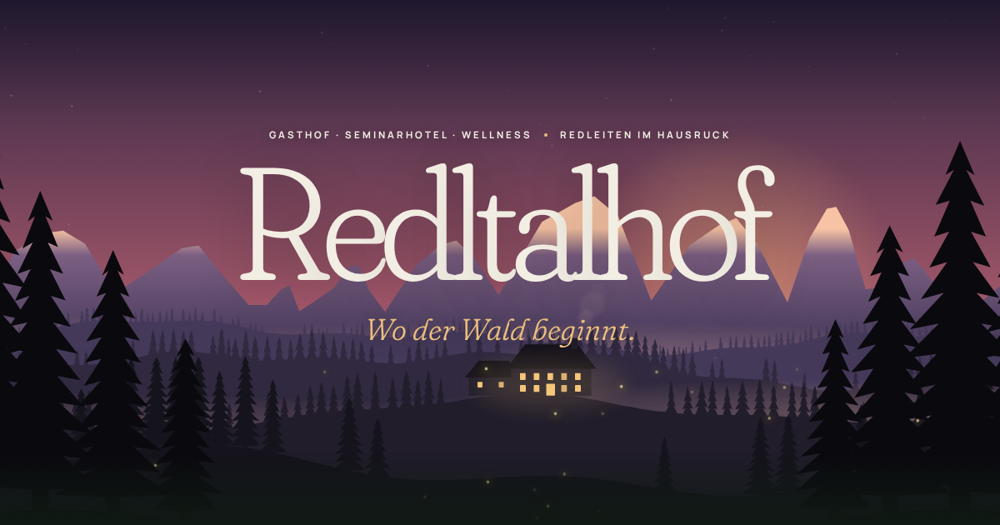

# Redltalhof – neue Website

Komplett neu gestaltete Website für den **Gasthof & Seminarhotel Redltalhof** in Redleiten (Hausruck, Oberösterreich).



## Das Konzept: „Wo der Wald beginnt.“

- **Lebendige Landschaft statt Stockfoto:** Der Hero ist eine mehrschichtige, prozedural erzeugte Alpen- und
  Fichtenwald-Szene mit Parallax, ziehendem Nebel, rauchendem Kamin, leuchtenden Hof-Fenstern, Sternen und
  Glühwürmchen. Sie passt sich der **Tageszeit der Besucher:innen** an (Morgengrauen, Mittag, Abendrot, Sternennacht)
  und lässt sich per Schalter umstellen.
- **„Ein Tag im Redltalhof“:** Horizontale Scroll-Reise von 07:00 bis 21:30 – der Himmel wandert vom Morgenrot bis
  zur Sternennacht mit.
- **Materialien zum Anfassen:** Holz, Leder, Leinen, Granit und Schmiedeeisen als generierte Oberflächen – genau die
  Materialien, mit denen das Haus renoviert wurde.
- **Interaktive Regionskarte** mit Entfernungen zu Frankenburg, Attersee, Salzburg, Linz & Co.
- **Seminar-Richtpreisrechner:** Teilnehmende, Tage und Verpflegung wählen – Richtwert erscheint sofort.
- **Anfrageformular** ohne Server (öffnet eine fertige E-Mail), später leicht an einen Formular-Dienst anzubinden.
- **Datenschutzfreundlich:** keine Cookies, kein Tracking, Schriften selbst gehostet (kein Google-Fonts-Abruf).
- Barrierearm (Tastatur, Screenreader-Labels, `prefers-reduced-motion`), responsiv, schnell (statisches HTML).

## Seiten

| Pfad            | Inhalt                                                            |
| --------------- | ----------------------------------------------------------------- |
| `/`             | Startseite                                                        |
| `/zimmer/`      | Zimmer & Suiten, Preise, Anfrage                                  |
| `/seminare/`    | Seminarräume, Vorteile, Richtpreisrechner, Ablauf, Anfrage        |
| `/gasthof/`     | Küche, Räumlichkeiten (Gaststube, Extrazimmer, Saal), Feste, Zeiten |
| `/wellness/`    | Hallenbad, Sauna, Dampfbad, Infrarot, Kneipp, Ritual              |
| `/region/`      | Redleiten, Karte, Ausflugstipps, Jahreszeiten                     |
| `/kontakt/`     | Kontakt, Anfrageformular, Anfahrt                                 |
| `/impressum/`, `/datenschutz/`, `404` | Rechtliches                                 |

## Entwicklung

```bash
npm install
npm run dev      # http://localhost:4321
npm run build    # statische Seite in dist/
npm run check    # Typprüfung
```

Technik: [Astro](https://astro.build) (statisch), Vanilla-TypeScript für die Interaktionen, Fraunces + Manrope via
Fontsource.

## Inhalte pflegen

- **Preise, Öffnungszeiten, Kontakt, Kennzahlen:** alles zentral in [`src/data/site.ts`](src/data/site.ts).
- **Fotos:** einfach in [`src/assets/photos/`](src/assets/photos/) legen – die Liste der Dateinamen steht in der
  dortigen [README](src/assets/photos/README.md). Solange kein Foto vorhanden ist, erscheint eine passende Illustration.
- **Impressum & Datenschutz:** Platzhalter (gelb markiert) in `src/pages/impressum.astro` und
  `src/pages/datenschutz.astro` ergänzen.

## Veröffentlichen (GitHub Pages)

1. Im Repository unter **Settings → Pages → Source** „GitHub Actions“ wählen.
2. Auf `main` pushen (oder den Workflow „Deploy to GitHub Pages“ manuell starten).

Für eine eigene Domain (z. B. `www.redltalhof.at`) wird der Basis-Pfad automatisch aus den Pages-Einstellungen
übernommen.

## Bitte vor dem Livegang prüfen

Die Inhalte stammen aus öffentlich verfügbaren Angaben (bisherige Website, Tourismusverband Oberösterreich).
Bitte vom Haus bestätigen lassen:

- Preise (Frühstück DZ 65,90 € / EZ 83,90 €, Vollpension DZ 94,00 € / EZ 112,00 €, Seminarpauschale 49,90 € p. P./Tag,
  Ortstaxe 2,40 €)
- Öffnungszeiten (Mi–Sa 15–24 Uhr, So & Feiertag 11–24 Uhr, Küche Mi–So 15–22 Uhr)
- Kennzahlen (30 Betten, Saal bis 50 Personen, Seminarräume ca. 40 bzw. 15–20 Personen)
- Entfernungen/Fahrzeiten auf der Regionskarte (gerundete Richtwerte)
- Impressumsangaben (Inhaber:in, UID, ggf. Firmenbuch) und Hosting-Anbieter im Datenschutz
